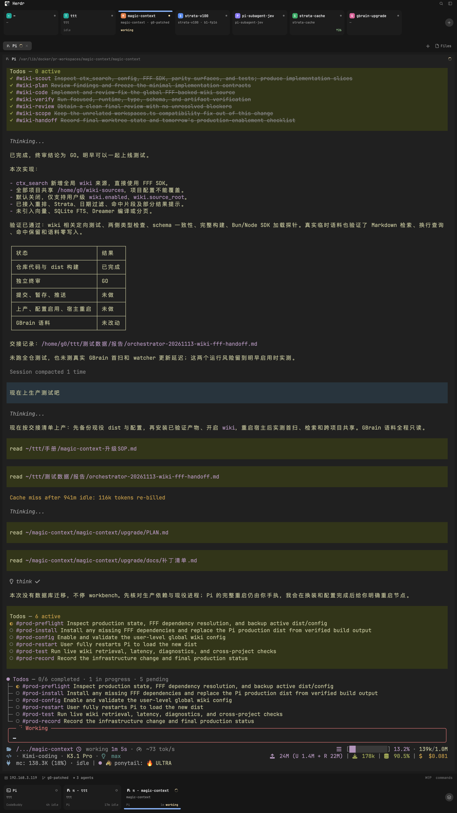

# portrait-cards

A portrait-friendly layout for the [Herdr](https://herdr.dev) desktop app:
horizontal project cards across the top, horizontal agent cards across the
bottom, and one large terminal between them. Active cards are transparent with
a 4px blue bar — on top for projects, on the bottom for agents.

- **Recipe:** [RECIPE.md](RECIPE.md) — the brief for rebuilding it from an
  empty folder.
- **Install:** copy `layouts/portrait-cards.json` into
  `~/.config/herdr-app/layouts/`, `mods/spaces-cards/` and
  `mods/agents-cards/` into `~/.config/herdr-app/mods/`,
  `themes/ghostty-mocha.json` into `~/.config/herdr-app/themes/`, merge
  `keys.json` into your own, then
  `herdr-app do layout.switch --name portrait-cards`. Never overwrite a name
  you already have.
- **Keys:** `PgUp` `PgDn` step through agents (fn-Up / fn-Down on a laptop,
  two ordinary keys on a mechanical board). They are bound in three sections
  of `keys.json` (`global`, `terminal`, `layout:portrait-cards`) because
  `terminal` outranks `global`. No arrow key is touched: `⌘←` / `⌘→` keep
  meaning start and end of line, `⌘↑` / `⌘↓` keep their history scrolling. The
  price of `PgUp` / `PgDn` is that `less`, `vim` and `htop` no longer receive
  those two keys for paging. `Home` / `End` are also pinned in `terminal` to
  the plain `ESC [ H` / `ESC [ F` sequences, because Herdr rewrites those keys
  for programs that negotiate the Kitty keyboard protocol. If a system
  remapper (Karabiner, etc.) turns Home / End into `⌘←` / `⌘→`, exempt Herdr
  from that rule first — otherwise the physical keys never reach the terminal
  at all. See RECIPE.md for both layers and the byte-level detail.
- **Right-click:** an agent card opens **New terminal** / **Split right** /
  **Split down** for that card's space and pane. A project card opens Herdr's
  own space menu, and terminal content opens its pane menu — **New terminal**
  is an item in both. Those two items live in Herdr's `menu` mod, so see
  RECIPE.md for the two one-line changes.
- **Trackpad swiping is not included.** Herdr turns a two-finger horizontal
  swipe into a `MouseDown(Navigate)` event, which neither `keys.json` nor a mod
  can read (the mod bridge reports it as `"left"`), so a swipe gesture needs a
  system-level listener outside Herdr. Upstream request:
  [herdr-app#249](https://github.com/herdrdev/herdr-app/issues/249).
- **Gallery:** this repo carries the `herdr-layout` topic, so it appears at
  herdr.dev/layouts.

`spaces-cards` and `agents-cards` are derived from Herdr's shipped `spaces`
and `agents` mods under the Apache License 2.0; see [NOTICE](NOTICE) and
[LICENSE-Herdr.txt](LICENSE-Herdr.txt).
