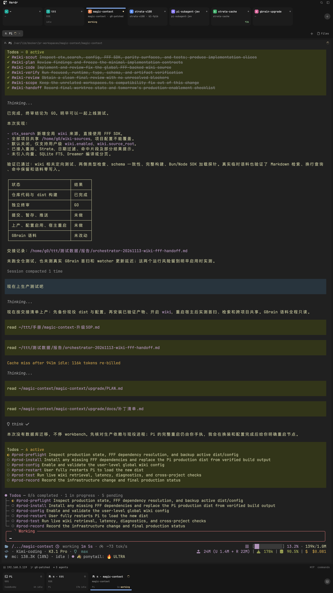

# Portrait Cards

A tall, quiet Herdr window: a slim brand strip, a band of horizontal project
cards across the top, one large terminal in the middle, and a band of
horizontal agent cards across the bottom. No sidebar, no pane borders, no card
titles, no machine names or IP addresses. The active card drops its fill and
outline altogether and is marked only by a 4px blue bar — on the **top** edge
for projects, on the **bottom** edge for agents. Built for a portrait window
(the preview is 2160x3840 physical pixels); the number of card columns follows
the window width.

## What you see

Top to bottom, at zoom 1 (the sizes below are as written in the layout; the
preview was captured at zoom 0.8):

- **Brand strip**, 46px, drawn by Herdr's `workspace-chrome`. It drags the
  window. macOS traffic lights sit at `[12, 16]`; the system title bar is
  hidden.
- **Projects band**, 110px, full width, panel fill `#161616`. Its root has
  12px side padding, 10px top/bottom padding, 8px gaps and an always-on
  vertical scrollbar. Cards are 84px tall, at least 120px wide, with 8px
  padding, 4px inner gaps and 10px corners; a 1px border is present but fully
  transparent. An idle card is `#1c1c1c`; hovering it lifts it to `#202020`
  with a `#454545` outline. The active card has no fill at all and a 4px
  `#89b4fa` bar across its top edge, rounded to the card's corners.
  Each card holds an 18px rounded letter tile (white initial on one of six
  colors: `#22a99a`, `#e3814f`, `#5b8def`, `#8b7cf6`, `#3fae6a`, `#d9649a`),
  the project name at 12px medium, a 6px status dot, a 10.5px muted
  `repo · branch` line (or an em dash), and a 10px dim line with the status
  word, `wt` for a worktree and `↑n` / `↓n` ahead/behind counts. A 28px round
  `+` button closes the last row, filled with `t.raised` (`#343434` here) —
  visibly brighter than the cards.
- **Work area**: a 42px tab strip, then the tab's terminals with 8px padding
  and gap, 10px corner radius, zero-width border and focus ring, a 30px pane
  header always shown on top, terminal padding `[14, 12]` and terminal
  background `#202020`. A 368px Files/Changes column exists but is hidden.
  A 28px status strip sits at the bottom of this area.
- **Agents band**, 110px, full width, same `#161616` panel and the same 84px
  card grid. Idle and hover fills are the same, but the active card's 4px blue
  bar runs along its **bottom** edge. Each card shows a 16px program icon, a
  12px name, a compact status badge, a 10.5px muted line with the project
  name (or an em dash), and a 10px dim line with the program name, elapsed
  time and status word. A 28px round sort button closes the last row.
- **Type and colour**: the root sets `Sarasa Mono SC XLight` at 18px for
  terminals and `JetBrains Mono` for the UI; card text is 12 / 10.5 / 10px.
  All dividers are 0px wide. The bundled theme `ghostty-mocha` gives
  background `#202020`, foreground `#c0c098`, cursor `#e2e8f0`, selection
  `#94a3b8`, 16 Catppuccin Mocha ansi colors, `accent` and `ring` `#454545`,
  and a fully transparent `border`. Three grays, darkest first: panel
  `#161616`, idle card `#1c1c1c`, terminal and hover `#202020`. No card is
  ever brighter than the terminal.

## How it behaves

- Column count is `max(1, floor((width - 24 + 8) / 128))`, recomputed when
  the block is resized; invisible spacers keep the last row's cards the same
  width. If the last row is exactly full, the round action button moves to a
  row of its own.
- Click a project card to select that space; right-click opens Herdr's space
  menu; dragging a card onto another reorders spaces, with a 2px accent line
  showing the insertion point. The round `+` creates a new space.
- Click an agent card to focus its pane. The card order is passed to
  `setAgentOrder()` on every render, so `cmd-up` / `cmd-down` and `cmd-left` /
  `cmd-right` (all four from `keys.json`) step through agents in the order the
  cards are drawn: left to right, then down. The round sort button opens a
  200x140 popup with
  **Priority** and **Grouped by space**; choosing one stores the choice and
  reorders the cards.
- Agent states: `working` is a 12px spinner turning once per 900ms plus the
  word `working`; `blocked` is a compact `!` badge in the blocked color on an
  alpha `26` fill; `done` is a 7px solid dot; `idle` is a 7px ring with a
  1.5px outline. Project cards show a 6px dot colored by their status and
  the status word. Status colors come from the theme.
- Project cards stay current: a 250ms timer looks for new or moved spaces,
  each place's branch and ahead/behind counts are read from git (also on
  remote machines), visible repos are rechecked every 60s, and a folder
  watcher wakes on local changes. The machine list refreshes every 15s.
- Hovering an idle card lifts its fill and shows the accent outline; hovering
  the active card changes nothing. Pinned agents, folding, sub-agent trees
  and the narrow rail are inherited from the shipped mods but never drawn in
  this layout.

## Built from

- `layouts/portrait-cards.json`: one `column` root with four children —
  `brand` (46px, `workspace-chrome`, `window_drag: true`), `spaces-panel`
  (`row`, 110px, `background: chrome`, a `spaces-cards` block), `work`
  (`column`: `tabs` 42px; `work-body` `row` with the active tab's pane block
  and a hidden 368px Files/Changes stack; `status` 28px), and `agents-panel`
  (`row`, 110px, `background: chrome`, an `agents-cards` block). Both bands
  are `resizable: false`; both blocks are `weight: 1` with `min: 90`. The
  root carries `theme`, `font`, `font_size: 18`, `ui_font`,
  `background: canvas`, `terminal_padding: [14, 12]`, `divider.width: 0`,
  `titlebar: none`, `traffic_lights: [12, 16]`, and
  `cloned_from: {name: main, version: 0.1.15}`. There is deliberately no
  `sidebar` node and no zero-height rail block.
- `keys.json`: three sections, each with the same four agent bindings —
  `global`, `terminal` and `layout:portrait-cards`. Use arrow keys to walk the
  card grid, because the cards are laid out left to right rather than top to
  bottom. All three are needed: `terminal` outranks `global`, so a global-only
  binding is shadowed while a pane is focused.
- `mods/spaces-cards/` and `mods/agents-cards/`: `main.js` plus `mod.json`
  (`place: none`), personal clones of Herdr's shipped `spaces` and `agents`
  mods. Keep the whole file: machine listing, git polling, status tracking,
  pin migration, labels, menus and ordering are the shipped logic. Only the
  tail of `render()` is replaced with the wrapping card grid
  (`cardRows()` / `card()`) and the two round action buttons.
- Shipped mods used but not included: `workspace-chrome` (brand strip and
  every `mods/workspace-chrome/*.svg` icon — `plus.svg`, `clock.svg`,
  `layers.svg`, `check.svg`, `spinner.svg`, `chevron-*.svg` and others used by
  the inherited row code), `tabs`, `pane`, `files`, `changes`,
  `workspace-status`, `menu` (the right-click popup) and the default `toast`.
- `herdr` functions: `spaces()`, `machines()`, `panes()`, `agents()`,
  `terminals()`, `focused()`, `theme()`, `layout()`, `window()`, `shared()`,
  `setShared()`, `setAgentOrder()`, `props()`, `openOverlay()`,
  `closeOverlay()`, `exec()`, `hc()`, `watchFolder()`, `run()` and
  `localStorage`.
- Commands the card path runs: `space.select`, `space.new`, `space.move`,
  `pane.focus`; `terminal.pin` migrates stored pins, and `agent.next` /
  `agent.prev` come from `keys.json`.
- Programs run: `git` (`rev-parse`, `symbolic-ref`, `rev-list`) through
  `exec`, in each project's folder and, for remote spaces, on that machine
  via `exec`'s `on:` argument; `hc machine ls --json` through `hc`. The
  inherited reconnect path can also run `hc machine rm` / `machine add`.
  There is no HTTP `fetch`.
- Outside their own folders: both mods read icons from Herdr's shipped
  `mods/workspace-chrome/`; `spaces-cards` runs git in the user's repos and
  watches those folders with `watchFolder()`. State is written only through
  `localStorage` and `shared()`.
- Art: letter avatars in six fixed colors, plus Herdr's shipped SVG icons.
  No fonts or images are bundled.

## Watch out

- **Start from clones.** Both mods are full copies of shipped `spaces` /
  `agents`, not small rewrites (`herdr-app do mod.clone`, or copy the shipped
  `main.js`). Replace only the tail of `render()`: a from-scratch card list
  loses git facts, agent statuses, pins, menus and ordering.
- **No `sidebar` node.** Both clones still contain `narrow()` and
  `toggleSidebar()` helpers that look for a `sidebar` node. With none present
  `narrow()` is always false, so the card grid is always drawn. Do not add a
  `sidebar` back without revisiting them, and do not bind
  `layout.toggle:sidebar` or `sidebar-rail.toggle`: neither has a target in
  this layout. The published build ships no rail mod and no `cmd-b`.
- **`cmd-left` / `cmd-right` are taken.** The `terminal` section overrides
  what those two keys normally send (Ctrl-A / Ctrl-E, beginning and end of
  line). If you want line editing back, drop them from `terminal` and keep
  only `cmd-up` / `cmd-down`, or rebind the agents to `cmd-alt-left` /
  `cmd-alt-right`. Ctrl-A / Ctrl-E still reach the shell when unbound.
- **Card fills are hard-coded.** `t.raised` is `#343434` in this theme — far
  brighter than the terminal — so idle cards use `#1c1c1c` and hover
  `#202020`, named `CARD_BG` / `CARD_HOVER` at the top of each `card()`.
  On a light theme both are wrong; pick new hex values. The two round action
  buttons still use `t.raised` and are visibly brighter than the cards.
- **Active state.** It is `bg("#00000000")` plus
  `border_color("#00000000")`, keeping `border_1()` so switching active state
  does not shift the card by 1px. The hover must be conditional
  (`.when(!on, ...)`) or it repaints the active card with a fill.
  `rounded_t(10)` / `rounded_b(10)` keep the 4px bar inside the card's
  corners; `t.ansi4` is the blue (`#89b4fa` here), with `#89b4fa` as the
  fallback in `ACTIVE`.
- **Fonts are not bundled.** `Sarasa Mono SC XLight` is a separately
  installed font (its SuperTTC is too large to ship); without it Herdr falls
  back to its own terminal font. `JetBrains Mono` ships with Herdr. Change
  the root `font` / `ui_font` for a self-contained build.
- **The theme travels with the layout.** Copy `themes/ghostty-mocha.json`
  into `themes/`; the root `theme` field names it. Never overwrite an
  existing theme with the same name — rename the file and the field together.
- **Icons are shipped assets.** The `mods/workspace-chrome/*.svg` paths are
  not in this folder; a Herdr release that renames them leaves blank buttons.
- **Sizes are fixed.** Cards are 84px tall inside a 110px band, so a second
  row needs the scrollbar. Text truncates with no full-name tooltip. The
  panel's `min: 90` sets the smallest useful band.
- **Personal settings are not shared.** `zoom`, `appearance`,
  `minimum_contrast` and telemetry are not in this folder. At zoom 1 the
  sizes above are literal; `preview.png` was captured at zoom 0.8.
- **No layout thumbnail.** The root has no `preview` field, so Settings shows
  the plain frame for this layout. `preview.png` is the gallery image only.
- **macOS framing.** `titlebar: none` and `traffic_lights: [12, 16]` were
  tuned for macOS; on Linux and Windows the bar mod draws the window buttons.

## Done when

- `herdr-app check ~/.config/herdr-app/mods/spaces-cards` and
  `herdr-app check ~/.config/herdr-app/mods/agents-cards` both print
  `check passed`.
- After copying `layouts/`, `mods/`, `themes/` into `~/.config/herdr-app/`,
  merging `keys.json` and running
  `herdr-app do layout.switch --name portrait-cards`,
  `herdr-app status` reports `"layout": "portrait-cards"` and `"errors": []`.
- The window shows a brand strip, a band of cards, one borderless terminal,
  then a band of cards — no sidebar and no footer buttons.
- Narrowing the window reduces the number of card columns; widening adds them.
- Selecting another project: its card turns transparent with a blue bar on
  top, and the previous card returns to `#1c1c1c`. Selecting another agent:
  its card turns transparent with a blue bar on the bottom.
- Hovering an idle card turns it `#202020` with a gray outline; hovering an
  active card leaves it transparent.
- `cmd-up` / `cmd-down` / `cmd-left` / `cmd-right` all move the active agent
  in the order the cards are drawn, including while a terminal pane has focus.
- The round `+` creates a space; the round sort button opens a popup with
  Priority and Grouped by space and picking one reorders the cards.
- `herdr-app shot` produces a frame with the same regions as `preview.png`.
